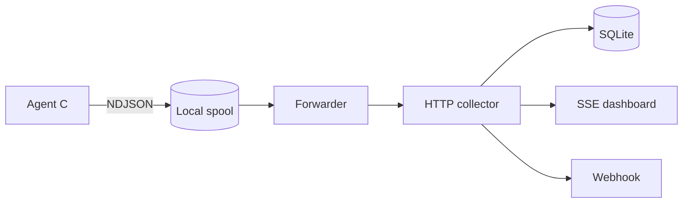

# SentryNOC Core

Observabilidade self-hosted, leve e orientada a Linux para servidores bare-metal, VPS e ambientes de nuvem.

[](#desenvolvimento)
[](#licença)

O SentryNOC Core coleta sinais diretamente do kernel, mantém as amostras localmente quando a rede falha e entrega um dashboard em tempo real sem exigir uma plataforma externa.

## Visão rápida



## Destaques

- Agente nativo em C, sem dependências de runtime.
- Leitura direta de `/proc` e `/sys` quando aplicável.
- CPU, memória, swap, PSI, disco e rede.
- Persistência local em NDJSON para tolerar falhas de conectividade.
- Coletor HTTP com SQLite.
- Dashboard em tempo real via Server-Sent Events.
- Alertas críticos via webhook com cooldown.
- Serviços systemd com privilégios reduzidos.
- Instalação automatizada em uma máquina Linux.

## Arquitetura

O sistema é separado por responsabilidade: o agente não precisa conhecer o banco; o forwarder cuida da entrega; o coletor concentra persistência, consulta e alertas.

Consulte [docs/architecture.md](docs/architecture.md) para o diagrama completo, decisões técnicas e sequência de uma amostra.

## Início rápido

### Executar localmente

```sh
make
make test
python3 collector/server.py
```

Em outro terminal, envie uma amostra:

```sh
./sentrynoc-agent --once --spool /tmp/sentrynoc.ndjson | \
  curl -sS -X POST http://127.0.0.1:8787/api/v1/ingest \
  -H 'Content-Type: application/x-ndjson' \
  --data-binary @-
```

Abra o dashboard em `http://127.0.0.1:8787/`.

### Instalar como serviço

```sh
sudo ./install.sh
```

O instalador prepara o agente, o coletor, o forwarder e os serviços systemd em `/opt/sentrynoc` e `/var/lib/sentrynoc`.

## Componentes

| Caminho | Função |
|---|---|
| `src/sentrynoc.c` | Agente de coleta nativo |
| `collector/server.py` | API, SQLite, SSE, dashboard e alertas |
| `collector/forward_spool.py` | Entrega contínua do spool com retry |
| `collector/replay_spool.py` | Reenvio manual de amostras |
| `systemd/` | Unidades de serviço |
| `install.sh` | Instalação operacional |
| `docs/` | Arquitetura, protocolo e operação |

## Métricas coletadas

| Grupo | Origem | Exemplos |
|---|---|---|
| CPU | `/proc/stat` | user, system, idle, iowait |
| Memória | `/proc/meminfo` | total, disponível, swap |
| Pressão | `/proc/pressure/*` | `some`, `full`, `avg10`, tempo acumulado |
| Disco | `/proc/diskstats` | operações, setores, tempo de I/O |
| Rede | `/proc/net/dev` | bytes, pacotes, erros e descartes |

O agente preserva contadores cumulativos. O coletor pode calcular taxas e percentuais comparando amostras consecutivas.

## API

| Método | Rota | Função |
|---|---|---|
| `GET` | `/healthz` | Verifica disponibilidade |
| `POST` | `/api/v1/ingest` | Recebe NDJSON |
| `GET` | `/api/v1/latest` | Retorna as últimas amostras |
| `GET` | `/events` | Stream SSE em tempo real |
| `GET` | `/` | Dashboard |

O contrato detalhado está em [docs/protocol.md](docs/protocol.md).

## Segurança e operação

Por padrão, o coletor escuta em `127.0.0.1`. Para proteger a API, configure um token:

```sh
SENTRYNOC_TOKEN=troque-este-token python3 collector/server.py
```

Em produção, use TLS reverso e não exponha o servidor diretamente na internet. O guia de configuração, diagnóstico e recuperação está em [docs/operations.md](docs/operations.md).

Alertas de pressão podem ser configurados assim:

```sh
SENTRYNOC_WEBHOOK=https://example.invalid/hook \
SENTRYNOC_PSI_ALERT=20 \
SENTRYNOC_ALERT_COOLDOWN=300 \
python3 collector/server.py
```

## Desenvolvimento

```sh
make              # compila o agente
make test         # executa uma coleta real
make run-collector
```

Validações recomendadas:

```sh
python3 -m py_compile collector/*.py
sh -n install.sh
```

## Roadmap

- Identidade e autenticação por agente.
- Cálculo de taxas e percentuais no coletor.
- Regras de alerta persistidas.
- Rotação e compactação do spool.
- Testes de carga e medição formal de RAM/CPU.
- TLS e implantação distribuída.

## Licença

Ainda não definida. Escolha e registre uma licença antes de publicar o projeto.
