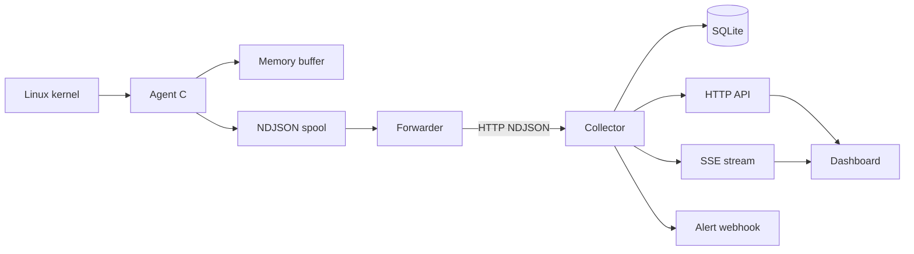
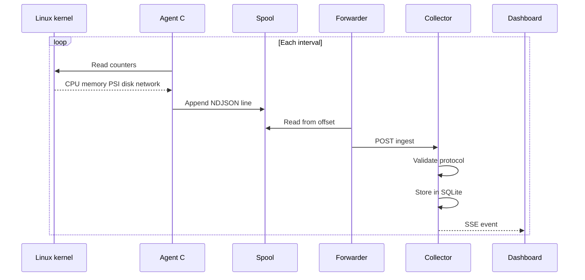

# Arquitetura

O SentryNOC Core é dividido em processos pequenos e independentes. O agente coleta dados do kernel; o forwarder entrega o spool; o coletor persiste e distribui os eventos.

## Responsabilidades

| Componente | Responsabilidade | Motivo |
|---|---|---|
| Agente C | Coletar métricas com poucas dependências | Baixo overhead e operação previsível |
| Buffer | Absorver pequenas interrupções de escrita | Evitar alocação e perda imediata |
| Spool | Persistir amostras localmente | Permitir recuperação após falha de rede |
| Forwarder | Enviar linhas novas e manter offset | Separar coleta de conectividade |
| Coletor | Validar, armazenar e distribuir | Centralizar regras e integrações |
| SQLite | Reter dados sem banco externo | Instalação simples |
| SSE | Atualizar o navegador em tempo real | Canal unidirecional suficiente para o dashboard |

## Ciclo de uma amostra

## Decisões

- Contadores cumulativos são preservados no agente; taxas e percentuais podem ser calculados no coletor usando duas amostras.
- O spool é append-only para tolerar interrupções no meio da escrita.
- O agente não depende de shell commands externos.
- O serviço systemd aplica privilégios mínimos e limita o caminho gravável.
