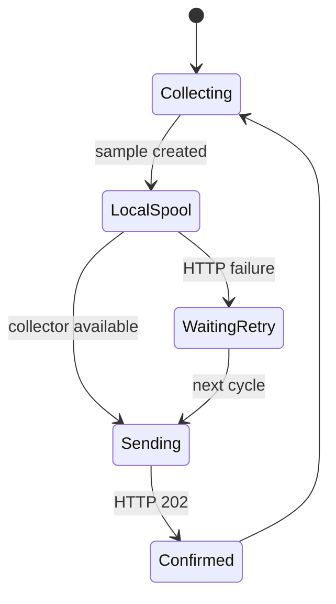

# Operação

## Desenvolvimento local

```sh
make
make test
python3 collector/server.py
```

Depois abra `http://127.0.0.1:8787/`.

## Instalação como serviço

```sh
sudo ./install.sh
```

O instalador cria:

- `/opt/sentrynoc`: binário e coletor;
- `/var/lib/sentrynoc`: SQLite, spool e offset;
- `sentrynoc-agent.service`: coleta;
- `sentrynoc-collector.service`: API e dashboard;
- `sentrynoc-forwarder.service`: entrega do spool.



## Configuração

| Variável | Padrão | Uso |
|---|---:|---|
| `SENTRYNOC_HOST` | `127.0.0.1` | Endereço do coletor |
| `SENTRYNOC_PORT` | `8787` | Porta HTTP |
| `SENTRYNOC_DB` | `sentrynoc.db` | Banco SQLite |
| `SENTRYNOC_TOKEN` | vazio | Token Bearer |
| `SENTRYNOC_WEBHOOK` | vazio | URL para alertas |
| `SENTRYNOC_PSI_ALERT` | `20` | Limiar de PSI crítico |
| `SENTRYNOC_ALERT_COOLDOWN` | `300` | Intervalo mínimo entre alertas |

## Diagnóstico

```sh
systemctl status sentrynoc-agent
systemctl status sentrynoc-collector
systemctl status sentrynoc-forwarder
journalctl -u sentrynoc-agent -f
curl http://127.0.0.1:8787/healthz
```

Para reenviar um spool manualmente:

```sh
python3 collector/replay_spool.py /var/lib/sentrynoc/telemetry.ndjson
```

## Segurança

Em produção, configure `SENTRYNOC_TOKEN` e coloque o coletor atrás de TLS reverso. O serviço escuta localmente por padrão para evitar exposição acidental.
